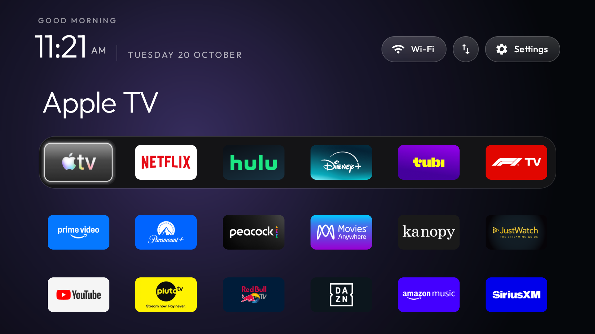

# Physical-device validation evidence

Samsung C71KW-200 / AT&T Osprey, Android TV 11, ARMv7.
Six columns, 24 apps, fill_dock:false, reduced motion enabled; app library,
module cards and advanced effects disabled.

This screenshot is from the installed 2.4-render-office.2 device build:
upstream 2.4 at 69c93b6 + performance PR39 at 3dc56d0 + selected PR370/330
rendering backports + the two reorder fixes. It is not a screenshot from the
newer contribution branch builds. Those branches were separately compiled,
unit-tested and linted; their complete newer code was not flashed to the TV.

Runtime checks covered native move/drop/save, cold launcher restart/order
persistence, all 24 tile positions and D-pad boundaries, app launch/Home,
and second Home. Deferred-refresh checks installed and removed a temporary
APK while editing, including focused removal and Home with a pending result.
The fixture and diagnostic logging were removed afterward.

